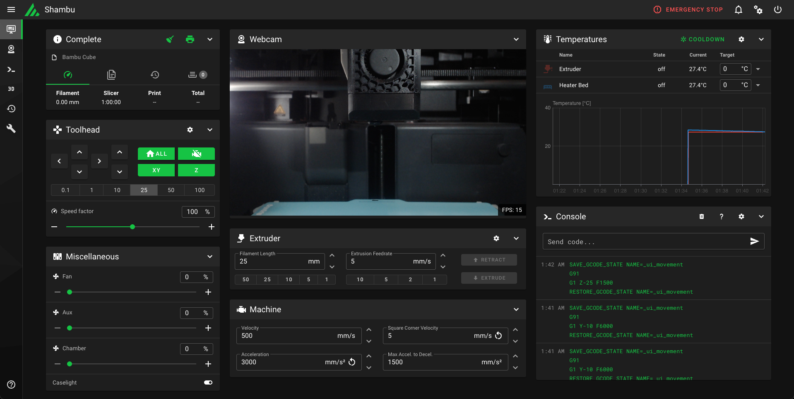

# Bambu Moonraker Shim

An experimental LAN bridge between Bambu Lab printers and Moonraker clients such as Mainsail and Fluidd. It translates a subset of Moonraker requests into Bambu MQTT and FTPS operations without installing Klipper or replacing printer firmware.

The current development printer is a **P1S**. Model-specific code exists for other printers, but that does not establish hardware compatibility across the P1, X1, A1, P2S or H2 families.

> This project is unofficial and unsupported by Bambu Lab. Printer firmware changes may break it. It is provided without warranty; physical controls require validation on your printer.



## Current status

“Implemented” means there is a code path, not that every printer has accepted the command. Automated and mock tests cannot confirm heater, motion or print behavior on hardware.

| Area | Current behavior | Validation and limits |
| --- | --- | --- |
| Connection and monitoring | LAN MQTT, reconnect snapshots, temperatures, print state/progress and filename | Observed on the development P1S. Not a model compatibility matrix. |
| Camera | Shared P1-style camera connection, MJPEG stream and snapshots | Observed on P1S; this is not a general RTSP camera implementation. |
| UI settings | Transactional SQLite storage through the Moonraker database API | HTTP/WebSocket saves, restart persistence and unchanged legacy JSON verified. |
| File browser | FTPS listing/download/upload/delete, real `.gcode.3mf` filenames | Live listing verified. Upload/delete flows tested with disposable mock files and mocked FTPS; printer acceptance still needs observation. |
| Print control | Start, pause, resume and cancel command paths | Controlled hardware acceptance tests remain pending. A successful API response is not printer confirmation. |
| Heaters and motion | Heater targets, homing, XYZ jogs, motor disable, fans, light and speed modes | Implemented; preserve the established heater-command choices until observed testing resolves firmware behavior. |
| External spool | Material presets, custom metadata, native load/unload requests | Payloads, persistence and UI tested; physical operations remain unverified. |
| File metadata and previews | Parse sliced 3MF and common plain G-code comments; persist previews in SQLite | Benchy archive verified locally and stored printer files verified through read-only FTPS; missing fields are omitted. See format and cache limits below. |
| History | Persistent terminal job records and progress estimates | Active jobs do not survive shim restarts intact. Filament consumption derived from progress remains an estimate. |

The Docker image bundles **Mainsail 2.19.0**, Fluidd, moonraker-cnc, the shim and Nginx. Mainsail has a build-time patch for 3MF files. Fluidd and CNC are fetched from their configured upstream URLs; their default references are not pinned to releases.

## Quick start with Docker

Requirements: Docker, a printer reachable from the container, its LAN access code and serial number. The API currently has no authentication and is intended for a trusted LAN.

```bash
git clone https://github.com/justinh-rahb/bambu-moonraker-shim.git
cd bambu-moonraker-shim
```

Create `.env` in the repository root, replacing the example values:

```dotenv
BAMBU_HOST=192.168.1.100
BAMBU_ACCESS_CODE=12345678
BAMBU_SERIAL=01P00A12345678
BAMBU_MODEL=P1S
BAMBU_MODE=local
BAMBU_FTPS_UPLOADS_DIR=/
```

`BAMBU_MODEL` is a model hint, not capability detection. Set it to the actual model. P1/A1 hints hide chamber temperature objects. The documented workflow is LAN mode; cloud environment variables in the source are not a supported cloud setup guide.

Create the persistence files **before** mounting them. `touch` preserves existing contents; do not replace an existing JSON file or database:

```bash
touch bambu_shim.db moonraker.json
docker build -t bambu-moonraker-shim .
docker run -d \
  --name fakeraker \
  --env-file .env \
  -p 7125:7125 \
  -p 8080:80 \
  -p 8081:81 \
  -p 8082:82 \
  -v "$PWD/bambu_shim.db:/app/bambu_shim.db" \
  -v "$PWD/moonraker.json:/app/moonraker.json" \
  bambu-moonraker-shim
```

| Service | Address |
| --- | --- |
| Mainsail | <http://localhost:8080> |
| Fluidd | <http://localhost:8081> |
| moonraker-cnc | <http://localhost:8082> |
| Moonraker-compatible API | <http://localhost:7125> |

The bundled UIs connect through Nginx. Port 7125 provides direct API access for other clients and the configuration helper below. Docker's supervisor fixes the internal API port at 7125; `HTTP_PORT` only changes the `python main.py` development server.

Inspect startup and connection errors with:

```bash
docker logs --tail 100 fakeraker
```

### Rebuild and replace an existing container

A build creates an image; it does not update a running container. With the printer idle, back up the persistent data, build the image, stop/remove the old container, then rerun the launch command above using the same mounts. Retain the old image or container if you need a rollback. Reusing the name requires removing or renaming the old container first.

The container must reach the printer's LAN address. MQTT uses port 8883; FTPS defaults to 990 and also uses passive data connections. The camera defaults to port 6000. Published ports above are for clients reaching the shim, not for reaching the printer.

### Durable Mainsail patch

Docker builds Mainsail 2.19.0 from checksum-pinned source using Node 22 and applies [the 3MF patch](docker/mainsail/3mf-support.patch) before compiling. It adds `.3mf` (including `.gcode.3mf`) to file lists, uploads, print actions and metadata refreshes, with case-insensitive extension checks. Unknown file timestamps display as `--` instead of an epoch date. The API preserves real filenames. Legacy `.gcode` aliases remain accepted where possible for older browser tabs; exact filenames take precedence.

3MF archives cannot be opened in Mainsail's plain-text editor or plain G-code viewer; those row actions are disabled. Showing a `.3mf` file does not mean it contains sliced toolpaths suitable for the printer.

The patch is part of each build and survives container recreation. Updating Mainsail requires reviewing the patch and updating the source checksum. Override the source with matching values when needed:

```bash
docker build -t bambu-moonraker-shim \
  --build-arg MAINSAIL_VERSION=2.19.0 \
  --build-arg MAINSAIL_SOURCE_SHA256=19908bcd07804328877cf1843c2436a5c66f66e7c417972a7cd262304057cbd6 \
  .
```

`MAINSAIL_SOURCE_URL` can override the archive URL. `FLUIDD_URL` / `FLUIDD_SHA256` and `CNC_UI_URL` / `CNC_UI_SHA256` override the other UI sources. See [Dockerfile](Dockerfile) for defaults. Unlike Mainsail's required checksum, the other checksum checks are optional.

### Mock mode

An empty `BAMBU_SERIAL` enables simulated printer state and local file operations. Keep mock data separate from real settings. Explicitly clear credentials and disable the camera:

```bash
docker run -d \
  --name fakeraker-mock \
  -p 18080:80 \
  -e BAMBU_SERIAL= \
  -e BAMBU_ACCESS_CODE= \
  -e BAMBU_HOST=127.0.0.1 \
  -e BAMBU_CAMERA_ENABLED=false \
  bambu-moonraker-shim
```

Open <http://localhost:18080>. This example has no persistent mounts; removing it discards its mock data. Mock print/heater behavior is not hardware validation.

## Persistence and the Moonraker database API

* `bambu_shim.db` is the authoritative SQLite store for UI settings, external-spool settings, webcams, file cache, metadata and job history.
* `moonraker.json` is a **one-time legacy import source**. The initial settings-store setup imports it, then leaves it untouched. An empty file is valid for a new installation. Malformed non-empty JSON stops startup so the source can be repaired and retried.

Keep the existing database mount across upgrades. New settings are not written back to JSON, and later edits to JSON are not automatically imported. A pre-existing SQLite settings store with its import marker does not re-import JSON. Back up SQLite using its backup API, or stop the container before copying the database. Keep a copy of legacy JSON during migration.

The database item/list API supports HTTP, WebSocket JSON-RPC and `POST /server/jsonrpc`. String keys use dots for nested fields; array keys preserve literal dots, such as filenames. Missing items return 404; stored JSON `null` returns success. POST requires `key` and `value`; DELETE returns the removed value. Internal namespaces are read-only through the public API. Maintenance entries are persisted normally.

This emulates Moonraker's API using the shim's own SQLite schema. It does not read a native Moonraker database, and database backup/restore API endpoints are not implemented.

`SHIM_DB_PATH` selects the SQLite file; `MOONRAKER_DB_PATH` selects the legacy JSON import source. The defaults match the Docker mounts above. Parent directories must exist when using custom paths.

## Running the Python server directly

Use **Python 3.11** to match the Docker runtime. A separately hosted Mainsail or Fluidd instance is needed for a UI; `main.py` serves the API.

```bash
python3.11 -m venv .venv
source .venv/bin/activate
pip install -r requirements.txt
python main.py
```

The server loads `.env` and listens on port 7125 by default. Point the separately hosted UI at `http://<shim-host>:7125`. This repository's Mainsail 3MF patch is applied by the Docker build; a stock external Mainsail instance will not inherit it.

Useful optional environment settings:

| Variable | Default | Purpose |
| --- | --- | --- |
| `HTTP_PORT` | `7125` | Port for `python main.py`; not the Docker supervisor port |
| `GCODES_DIR` | `gcodes` | Local files in mock mode |
| `BAMBU_CAMERA_ENABLED` | `true` | Enable the built-in camera bridge |
| `BAMBU_CAMERA_PORT` | `6000` | P1-style camera port |
| `BAMBU_CAMERA_USERNAME` | `bblp` | Camera username; access code is the password |
| `BAMBU_FTPS_PORT` | `990` | Printer FTPS port |
| `BAMBU_FTPS_USER` | `bblp` | FTPS username |
| `BAMBU_FTPS_PASS` | LAN access code | FTPS password override |
| `BAMBU_FTPS_UPLOADS_DIR` | `/` | Printer directory backing the `gcodes` root |

## Files and print start

The `gcodes` root lists `.gcode`, `.gcode.3mf` and `.3mf` files from printer FTPS. The `config` root contains virtual compatibility files; it is not an editable Klipper configuration. Config uploads/deletes are not supported.

HTTP and WebSocket file-list/directory APIs return real filenames. Deletion supports HTTP and `server.files.delete_file`, returns failures explicitly, invalidates the cache after success, and broadcasts `notify_filelist_changed`. Deletion is blocked while print state is printing or paused. Root listings are cached for up to five minutes; uploads and deletions invalidate the cache. Subdirectory uploads, directory creation, rename and duplicate operations are not implemented, even though clients may show those actions. A normal UI refresh can still use the cached root listing.

Print start accepts a file already on the printer. For `.3mf`, it requests `Metadata/plate_<number>.gcode` from the archive; the default plate is 1. Upload can request auto-start using the multipart `print` flag. Files must already be sliced for the actual printer; the shim does not slice, convert arbitrary G-code, validate toolpaths or replace Bambu machine profiles.

Use a known-good Bambu-compatible sliced file for an observed print test. Print-start payloads and mock flows are tested, but real print-start acceptance remains pending. A successful API response or `print_started: true` indicates the command path succeeded, not that the printer began printing.

### Stored-file metadata and thumbnails

`GET /server/files/metadata?filename=<path>` and `server.files.metadata` parse the requested file. They return actual source size and available slicer values: slicer/version, print-time estimate, object/layer heights, layer count, nozzle diameter, temperatures, filament length in millimetres, weight in grams, material/name/colour and preview details. These are slicer estimates, not measurements of a completed print. Missing fields are omitted rather than borrowed from the active job or filled with synthetic defaults.

Sliced 3MF parsing reads `Metadata/plate_1.gcode`, matching plate PNG previews and, where present, `Metadata/slice_info.config`. Plain G-code supports common Bambu/Orca/Prusa/Cura comments and embedded base64 PNG/JPEG previews. An unsliced project archive has no printable plate metadata and returns an explicit error. No paths are extracted from an archive to disk.

Metadata defaults to plate 1 when present, otherwise the first sliced plate in the archive (single-plate exports can retain another plate number). The optional `plate` parameter selects another positive plate number for metadata/scan/thumbnail requests; `plate_count` describes the sliced plates found in a 3MF. Mainsail's ordinary file list uses this automatic selection. Metadata plate selection does not change the plate used by print start; an export containing only plate 4 still needs `plate=4` in its print-start request.

The first scan downloads the source over FTPS and can take time; subsequent requests use the cache. Metadata and preview bytes persist in `bambu_shim.db`. Cache keys include the filename, plate, parser version, source size and modification time. Upload/delete invalidates affected metadata; changed source fingerprints cause re-parsing. Root FTPS listings can remain cached for five minutes. Use **Scan Metadata** (`server.files.metascan` or `POST /server/files/metascan?filename=<path>`) to force a fresh listing and scan. If FTPS provides no timestamp, `modified` is zero (unknown), and metadata is re-read after five minutes to catch same-size changes.

A 64 px list thumbnail is generated when embedded previews do not fit Mainsail’s icon size; original previews are retained. Preview records use Moonraker-relative `.thumbs/` URLs served from SQLite, without writing previews to the printer. `server.files.thumbnails` and `GET /server/files/thumbnails` expose thumbnail details. Parsing is bounded to 256 MiB source files, 128 MiB per archived G-code member, 4 MiB XML configuration and 8 MiB per preview; oversized/unsupported archives return errors. Other archive layouts, binary G-code and non-PNG/JPEG thumbnail formats are not supported.

## Heater behavior

The established outgoing heater commands are **M109, M190 and M191**. Both the corresponding wait and non-wait input commands (`M104`/`M109`, `M140`/`M190`, `M141`/`M191`) are intercepted and routed through the same heater functions. `SET_HEATER_TEMPERATURE` uses those functions too.

**Non-blocking input does not currently preserve non-blocking semantics.** Whether native non-wait commands work reliably on the development printer remains unresolved. The API does not wait for the heater to reach its target before replying. Locally tracked targets can appear before telemetry confirms them.

Examples of accepted console commands:

```gcode
M109 S220
M190 S60
SET_HEATER_TEMPERATURE HEATER=extruder TARGET=220
SET_HEATER_TEMPERATURE HEATER=heater_bed TARGET=60
```

The shim validates targets against fixed software ranges: extruder 0–300°C, bed 0–120°C, chamber 0–70°C. These are not detected hardware limits. P1/A1 model hints hide chamber temperature controls; exposing a chamber object on another model does not establish that it has an active chamber heater.

## Controls and built-in macros

Supported command paths include homing, XYZ movement, motor disable, chamber light, fan controls and print-speed selection. `M220` percentages map to the nearest Bambu preset: silent 50%, standard 100%, sport 124%, ludicrous 166%. This is not continuous Klipper speed scaling.

| Fan | MQTT G-code mapping |
| --- | --- |
| Part cooling | `M106 P1` |
| Auxiliary | `M106 P2` |
| Chamber/exhaust | `M106 P3` |

Fan values are normalized and clamped to 0–255. Actual fan availability depends on the printer.

The shim implements a fixed set of macro handlers; it does not execute user-defined Klipper/Jinja macros.

| Macro | Implemented action |
| --- | --- |
| `PRINT_START` / `START_PRINT` | Send G28, then optional bed, nozzle and chamber targets |
| `PRINT_END` / `END_PRINT` | Request heater targets of zero, part/aux fans off, then M84; does not explicitly switch off the chamber fan |
| `HEATERS_OFF` / `TURN_OFF_HEATERS` | Request heater targets of zero |
| `PAUSE` / `RESUME` / `CANCEL_PRINT` | Send the corresponding native print-control command |
| `BED_MESH_CALIBRATE` | Accepted as a no-op; does not request leveling |

Start macros accept `BED` / `BED_TEMP`, `HOTEND` / `EXTRUDER` / `EXTRUDER_TEMP`, and `CHAMBER`. For example:

```gcode
PRINT_START BED=60 HOTEND=220
```

This is a compatibility handler, not a replacement for a Bambu slicer's complete start sequence. It does not request leveling. Native file-print start has a separate bed-leveling option. Existing Klipper slicer profiles are not automatically compatible.

### External spool

One-click macros `SET_PLA`, `SET_PETG`, `SET_ABS`, `SET_ASA`, `SET_TPU`, `SET_PC` and `SET_PA` select a generic material profile and nozzle range while preserving the current colour. They change filament metadata without heating or moving the printer. The defaults are editable metadata, not universal temperature recommendations for every filament brand.

For custom settings:

```gcode
SET_EXTERNAL_FILAMENT MATERIAL=ABS COLOR=FFFFFF
```

`COLOR` accepts `RRGGBB` or `RRGGBBAA`, optionally prefixed by `#`. Optional `TEMP_MIN`, `TEMP_MAX` and `PROFILE_ID` override defaults. Custom material names require an explicit profile and temperature range. Omitting fields preserves current reported/saved values; changing material resets the profile and range to that material's defaults.

Load/unload use native Bambu external-spool commands and **may heat and move the printer**. They need an operator present. The operator has verified initial load and unload on the P1S; the load-confirmation responses below still need hardware verification:

```gcode
UNLOAD_EXTERNAL_FILAMENT TEMP=260
LOAD_EXTERNAL_FILAMENT
```

Without `TEMP`, unload uses the midpoint of the reported/saved nozzle range. Unknown material temperature requires an explicit value. `LOAD_FILAMENT` and `UNLOAD_FILAMENT` remain external aliases when AMS parameters are absent.

When the printer asks **Has filament extruded?**, use `EXTERNAL_FILAMENT_EXTRUDED` for **Yes / finish**, or `EXTERNAL_FILAMENT_RETRY` for **No / retry extrusion**. These macro buttons send native `ams_control` responses (`done` / `resume`), rather than print-resume commands. They require a matching printer-reported question and confirmed external-spool selection, and are blocked during printing/paused states. The macro variable `awaiting_extrusion_confirmation` tracks the question across telemetry deltas; firmware reports clear it. No automatic dialog is displayed yet; use the External Spool macro buttons.

The handlers support one external spool on a single-nozzle printer. They refuse external operations when disconnected, printing/paused, missing an idle-state report, or using an AMS tray. Dual-external/dual-nozzle routing is not implemented. AFC integration for AMS is future work; existing AMS command paths do not constitute a validated AFC interface.

Settings persist in namespace `bambu_shim`, key `external_filament`. Macro variables distinguish saved/requested values from confirmation via `sync_state` and report matching rejections in `last_error`. Loaded state comes from telemetry (or simulation in mock mode), not from publish success. See [external spool implementation notes](research/external-spool-macros.md).

Mainsail basic mode discovers the buttons automatically. Existing expert-mode layouts may hide new macros. Add them through macro settings, or run this helper with the Python dependencies installed:

```bash
python scripts/configuration/install_external_spool_panel.py --url http://localhost:7125
```

It adds an External Spool group while preserving existing groups/layout entries and sends no printer command. The parameter menus come from the shim's virtual configuration.

## Remaining gaps

* Physical acceptance tests for print start, heater semantics, external load confirmation/retry and other controls. Initial external load and unload have been operator verified.
* Reliable command acceptance/error reporting: most MQTT controls publish in background tasks, so an API success can precede a transport failure or printer rejection. External-spool commands await transport delivery, which still is not physical completion.
* More slicer metadata formats and preview encodings. Current parsing supports Bambu/Orca sliced 3MF layouts and common Bambu/Orca/Prusa/Cura G-code comments; unsupported or absent fields are omitted.
* Durable active-job recovery across restarts and more accurate history accounting.
* Full console response/history support, custom macros, job queueing and AMS/AFC UI integration.
* File rename/duplicate, directory mutation and subdirectory uploads.
* Per-client status subscription filtering; current broadcasts are global.
* Full HTTP/WebSocket API parity, native Moonraker database interoperability and backup/restore endpoints.
* Camera/model support beyond the currently observed P1S path.

## Troubleshooting

**Connection:** verify IP, serial, access code and container-to-printer reachability. Use the printer's LAN-only mode for the documented setup. Inspect `docker logs fakeraker` for MQTT/FTPS errors.

**Settings:** confirm `/app/bambu_shim.db` is mounted as a writable file. Saves belong there, not in `moonraker.json`. For initial migration errors, repair a copy of the legacy JSON and preserve the original. Do not delete the live database to force an import.

**Missing 3MF files after an upgrade:** refresh/reopen Mainsail so its service worker can load the new build; try a hard refresh if needed. Check `http://localhost:8080/.version` reports `v2.19.0`. An externally hosted stock Mainsail does not include this patch.

**File operations:** verify FTPS credentials and passive connectivity. Root listings may remain cached for five minutes; pressing Refresh alone does not force cache eviction. Config files are read-only, and some visible client file actions are unimplemented. Inspect API errors rather than assuming a button succeeded.

**Heaters:** use the established heater path above and observe actual telemetry. Repeated non-wait inputs do not test native non-wait behavior because the shim translates them. A changed target display does not prove the printer accepted a command.

**Missing external macros:** check Mainsail's basic/expert layout and run the group helper if needed. Macro names are case-insensitive; parameter validation failures appear as API errors.

## Development and contributing

Run automated checks with the Python dependencies installed:

```bash
python -m unittest discover -s tests -v
```

Tests use temporary stores and mocked transports. Hardware diagnostics under `scripts/diagnostics/` are separate and require intentional invocation. The mock-only file smoke check refuses a configured real printer:

```bash
docker exec fakeraker-mock python -m scripts.validation.smoke_file_delete
```

As of the 2026-10-26 review, 112 automated tests passed locally and in Docker with networking disabled. Mock upload/delete and browser checks passed; these do not close the physical-test gaps above. See [the compatibility review](research/2026-10-26-compatibility.md) for evidence, protocol references and remaining work, including comparisons with Bambuddy.

Contributions should include relevant validation and documentation. Target the repository's `master` branch.

## License

The shim is MIT licensed; see [LICENSE](LICENSE). Bundled upstream UIs retain their own licenses.
